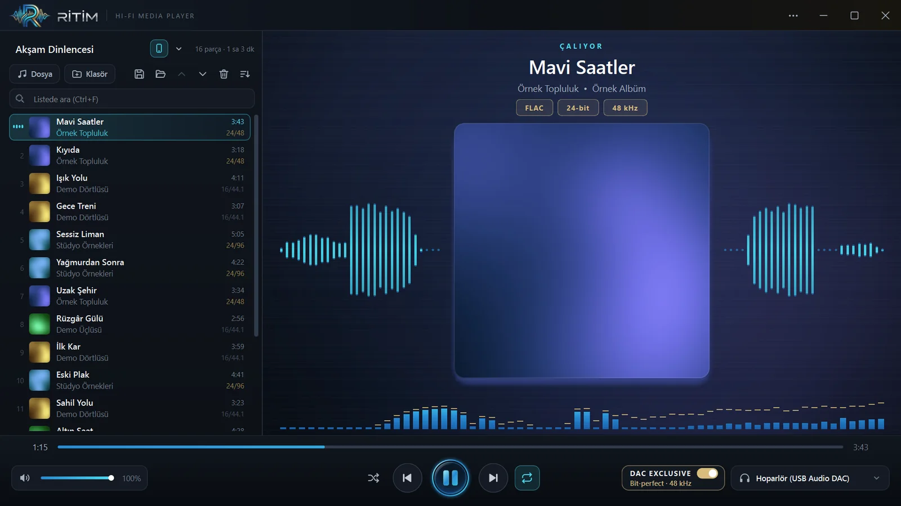
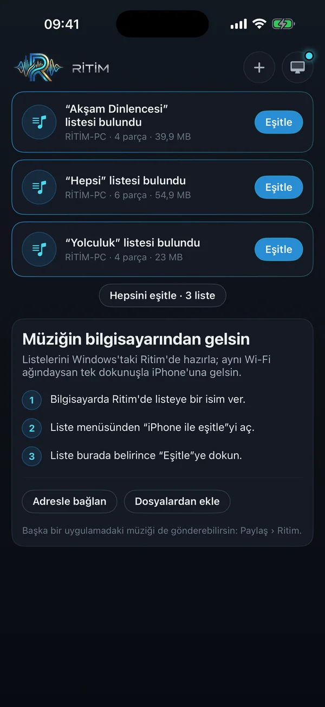
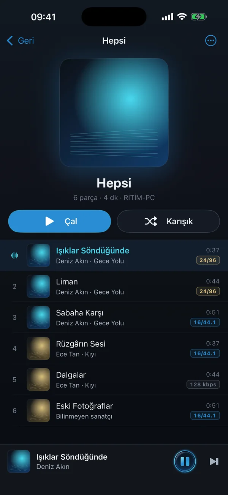
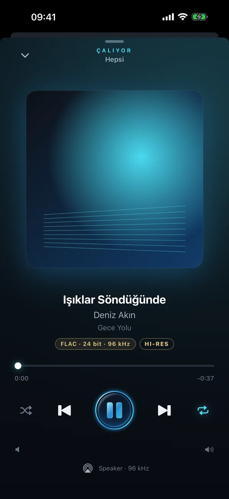

<h1 align="center">Ritim</h1>

<b>Kendi müzik dosyaların için hi-fi çalar.</b> 
FLAC ve diğer biçimleri kayıpsız, DAC Exclusive ile bit-perfect çalar; listelerin Wi-Fi ile iPhone'una gelir.

  <a href="https://whosaidreal.github.io/ritim-app/indir.html"><b>⬇ İndir</b></a> ·
  <a href="https://whosaidreal.github.io/ritim-app/">Tanıtım sayfası</a> ·
  <a href="https://whosaidreal.github.io/ritim-app/destek.html">Destek</a> ·
  <a href="https://whosaidreal.github.io/ritim-app/gizlilik.html">Gizlilik</a>

Bu depo Ritim'in herkese açık sayfalarını ve Windows sürümlerini barındırır. Kaynak kodu burada değildir.

## İndir

| | |
|---|---|
| **Windows, kurulum programı** | [Ritim_Setup.exe](https://github.com/whosaidreal/ritim-app/releases/latest/download/Ritim_Setup.exe): yönetici izni istemez, Başlat menüsüne ve masaüstüne ekler |
| **Windows, taşınabilir** | [Ritim_Portable.exe](https://github.com/whosaidreal/ritim-app/releases/latest/download/Ritim_Portable.exe): kurulmadan, tek dosya olarak çalışır |
| **Windows, Microsoft Store** | [Microsoft Store'da aç](https://apps.microsoft.com/detail/9NR2T597168G): kendiliğinden güncellenir, uyarı göstermez |
| **iPhone, App Store** | [App Store'da aç](https://apps.apple.com/app/id6835273556): listelerini bilgisayardaki Ritim'den alır |

Windows 10 (1809 ya da sonrası) ve 11, 64 bit; iPhone'da iOS 16 ya da sonrası. Buradaki dosyalar kod imzalı değil:
Windows "Windows kişisel bilgisayarınızı korudu" derse **Ek bilgi › Yine de çalıştır**. Her sürümün SHA-256 özeti
[sürüm notunda](https://github.com/whosaidreal/ritim-app/releases) yazar. Bilgisayarda tek bir Ritim kalır: kurulum
programı Microsoft Store sürümünü bulursa onun yerine geçmeyi önerir; listelerin ve ayarların korunur.

## Neler yapar?

- **Bit-perfect çalma:** DAC Exclusive açıkken ve ses %100'deyken örnekler DAC'ına dosyadaki hâliyle gider. Biçim, bit
  derinliği ve örnekleme hızı her an görünür.
- **Her biçim, boşluksuz:** FLAC, ALAC, WAV, AIFF, MP3, AAC/M4A, Ogg Vorbis, Opus ve WMA çalar; parçalar arasında
  boşluk yoktur.
- **Kapağın renginde:** arayüz ve görselleştirici albüm kapağının rengine bürünür. Listede anında arama, sıralama ve
  sürükleyerek düzenleme.
- **iPhone'a kablosuz:** bir kez 6 haneli kodla eşleşirsin; listelerin kapaklarıyla Wi-Fi üzerinden iPhone'una iner ve
  internet olmadan da çalar.
- **Ses CD'leri:** CD diskten dijital olarak okunur ve kendi kalitesinde çalar. Şarkı isimleri diskte yazılıysa oradan,
  değilse izin verirsen MusicBrainz'den ve parçanın ses izinden (AcoustID) bulunur. İstersen CD takınca Ritim açılır;
  CD'ye sağ tıklayınca da "Ritim ile çal" çıkar.
- **Ayrıca:** medya tuşları, görev çubuğu önizlemesinde oynatma düğmeleri, ReplayGain, M3U, M3U8, PLS ve WPL listeleri;
  Türkçe ve İngilizce arayüz.

  
  
  

Hesap, reklam ya da veri toplama yoktur; Ritim internete yalnızca, izin verirsen, ses CD'lerinin şarkı isimlerini bulmak
için bağlanır.

Ritim, açık kaynaklı bileşenleri (Qt / PySide6, PortAudio, libsndfile ve diğerleri) değiştirmeden içerir. Lisansları:
[THIRD_PARTY_NOTICES.txt](THIRD_PARTY_NOTICES.txt).

---

**English.** This repository hosts the public pages and the Windows releases of Ritim; the source code is not here.
Ritim is a free hi-fi music player for Windows that plays the music files on your PC in full lossless quality, and
bit-perfect with DAC Exclusive on. Its iPhone app receives your playlists over Wi-Fi and plays them offline. It plays
audio CDs too and, if you allow it, finds their track names online. No account, no ads, no data collection; the
interface is in English and Turkish.
[Download](https://whosaidreal.github.io/ritim-app/indir.html) ·
[Support](https://whosaidreal.github.io/ritim-app/destek.html#en) ·
[Privacy](https://whosaidreal.github.io/ritim-app/gizlilik.html#en).
It is also on the [Microsoft Store](https://apps.microsoft.com/detail/9NR2T597168G), which updates it automatically, and
the iPhone app is on the [App Store](https://apps.apple.com/app/id6835273556). The installer here is not code-signed, so
Windows may warn on first start (More info › Run anyway). Each release lists the SHA-256 of its files. The app bundles
unmodified open-source components; see [THIRD_PARTY_NOTICES.txt](THIRD_PARTY_NOTICES.txt) for their licences.
